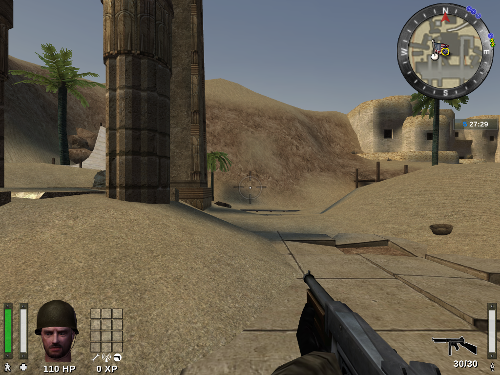

# ETPad

**Wolfenstein: Enemy Territory on Apple silicon Mac and iPad, built on ET: Legacy.**

Controller first, with a native iPad touch overlay, native settings, and separately acquired original game data. ETPad preserves the upstream engine and Legacy mod history while adding Apple integration under [`apple/`](apple/).

[Build](#build-from-source) · [Game data](#get-the-original-game-data) · [Controls](#play-with-a-controller-or-touch) · [Status](#what-is-verified) · [Developer guide](docs/BUILDING.md)



*Actual macOS Oasis gameplay after a respawn regression check. Original game media is used locally and is not included in the repository or exported apps.*

> **Development preview — experimental.** macOS has verified local bot rounds and a sustained public Legacy session. iPad Simulator runs real local and public gameplay, including touch-driven team/class selection, local map reload, automatic public map rotation and reconnect. An assisted Oasis bot round now passes through death, respawn, objective capture and timed intermission, with first-tap team/class selection. Physical iPad play and physical controller feel are unverified. The device IPA is unsigned. See the [acceptance record](docs/HANDOFF.md) before treating a build as ready to play.

## What is verified

Build success, simulator behavior, and physical-device play are tracked separately.

| Target | Recorded evidence | Remaining limits |
| --- | --- | --- |
| **macOS · arm64** | Source-built engine, renderer and Legacy modules; Oasis and Goldrush bot rounds through intermission; public Legacy session exceeding ten minutes, including map change and reconnect | Gameplay input was injected. Physical controller play has not been tested. Optional Omni-bot core is a separate, prebuilt macOS dependency. |
| **iPad Simulator · arm64** | Native data acquisition; signed embedded frameworks; real local/public gameplay; first-tap Allies → engineer → OK → spawn; source-built Omni-bot 0.93 with four active Oasis bots, touch fire/reload, death/respawn, assisted objective capture and timed intermission; Oasis → Goldrush local reload; public Railgun → Fuel Dump and Fuel Dump → Oasis rotations, each with post-rotation reconnect in its original app process; landscape and suspend/resume | Bot-round input and objective travel were assisted, including developer positioning and god mode. Multi-touch feel, physical controllers and physical keyboard/trackpad use remain unverified. |
| **Physical iPad** | Fresh bot-enabled unsigned arm64 iOS app/IPA passes architecture, dependency, notice and package checks | No device or signing identity was available; no installation, performance, bot or public-server acceptance is claimed. |
| **PadMint** | Build interface and manifest validation against a read-only snapshot of PadMint main | Targets remain `experimental`, manifest status `draft-untested`; no catalog listing or release acceptance. |

The [handoff](docs/HANDOFF.md) contains exact checkpoints, assisted test procedures, failure logs and remaining gates. The [final artifact audit](docs/evidence/package-resumed.txt) covers the Mac package, default ANGLE and optional Vulkan simulator apps, and bot-enabled unsigned device app/IPA. The [HUD-placement refresh](docs/evidence/package-placement.txt) repeats these package checks after the control changes. The accepted iPad bot round used assisted input, developer positioning and god mode for objective interaction; it does not establish unassisted play.

### What the Apple port adds

- **Shared controller layout:** analog movement/look, trigger actions, utility and weapon layers, persistent remapping, and held-input cleanup on disconnect.
- **Native iPad controls:** a larger Fire target, readable icon/caption buttons, Use and weapon cycling within the combat arc, and a narrow Score/Menu gutter that leaves movement and the HUD clear. Black translucent resting buttons gain color only while pressed; movement/look guides appear during use or arrangement.
- **Native three-dot menu:** Play, Settings and Tools groups organize controller mappings, touch visibility/size/opacity/handedness/layouts, render resolution, FOV and FPS settings, player name, favorites, game data, Console, Game Keyboard, and report preview.
- **Original-data acquisition:** official download or Files import, with SHA-256 verification before installation. The app package carries no original `pak0.pk3`, `pak1.pk3` or `pak2.pk3`.
- **iPad rendering through Metal:** the source-built GL4ES adapter feeds ANGLE's Metal backend. UIKit owns presentation and lifecycle; embedded frameworks provide the engine and built-in Legacy modules.

The [native UI pass](docs/UI-DESIGN.md) includes before/after screenshots and verified simulator actions. Scoreboard/intermission state hides combat buttons so they do not cover the table. Score remains available for release; the connection hint clears after eight seconds during play. Touch layout settings and named presets persist. Arrange mode opens and closes, but the current automated drag check did not establish position changes; physical usability remains a testing gate.

## Get the original game data

ETPad's engine code and Wolfenstein: Enemy Territory's original media have different licenses. You need all three original files: `pak0.pk3`, `pak1.pk3`, and `pak2.pk3`. They are acquired separately and never included in exports.

### On iPad

1. Open ETPad. Missing data opens the native setup screen.
2. Choose the official download, or import the three original files using Files.
3. Wait for verification to complete, then choose **Play**.

The downloader uses the [official Splash Damage archive](https://www.splashdamage.com/games/wolfenstein-enemy-territory/). It verifies the archive and each original pak, reads only the fixed data payload, and never runs the bundled installer, setup or key programs. Import verifies the complete set before replacing installed data and retains unrelated files such as `etkey`.

The three-dot menu provides data download, import and confirmed removal. If the engine has already started, removal is scheduled for the next launch. Saves and downloaded maps remain separate.

### On Mac or for local development

From the repository root:

```sh
/usr/bin/python3 scripts/prepare-game-data.py --download
```

Or import existing originals:

```sh
/usr/bin/python3 scripts/prepare-game-data.py --import-from /path/to/etmain
```

The helper writes to ignored `game-data/etmain`. It does not add media to an app. Follow the [Mac launch instructions](docs/BUILDING.md#current-entry-points) to supply a separate local data directory.

See [game-data provenance, SHA-256 values and EULA notes](docs/GAME_DATA.md). Original media is governed by its original EULA, separately from the GPL engine.

## Play with a controller or touch

Apple builds enable the default controller layout once per profile. Xbox labels below describe physical positions; PlayStation and MFi equivalents use the same actions. iPad prompts distinguish controller families, and touch controls can hide when a controller is connected.

| Input | Action |
| --- | --- |
| Left / right stick | Analog movement / look |
| RT / LT | Fire / alternate weapon |
| A / B / X / Y | Jump / crouch / reload / use |
| L3 / R3 | Sprint / prone |
| Back / Start | Scoreboard / game menu |
| D-pad up / down / left / right | Map / limbo / previous / next weapon |
| Hold **LB** | Utilities: lean, vote, console, team/class menus and team quick chat |
| Hold **RB** | Weapon banks 1–10 |

Triggers remain usable while a shoulder layer is held. Releasing a layer does not strand an action held in that layer; detaching the controller clears held inputs and movement axes. The [full binding table](docs/CONTROLS.md) explains every combination and how to restore defaults. iPad exposes native remapping; Mac bindings are editable through the ET console.

On iPad, use the three-dot menu to show touch controls, change opacity/size/handedness, enable controller auto-hide, and manage layouts. Native **Game Menu**, **Console**, and **Game Keyboard** are available there. Touch selection inside ET's rendered menus now has a verified Limbo → Allies → engineer → OK → spawn flow without a crash. An initial one-event pointer lag was corrected; the subsequent Allies → engineer → OK selection worked on the first tap.

Controller evidence currently comes from SDL virtual-controller component tests and Simulator virtual-Gamepad prompts. Neither establishes physical controller play. Touch fire and reload were exercised in actual simulator gameplay; multi-finger feel needs a physical iPad.

## Online play and compatibility

The goal is interoperability with existing PC ET: Legacy servers. macOS completed a public Legacy session through a map change and reconnect. iPad Simulator completed fresh joins and gameplay on a pure Legacy server, including normal data-pack downloads. A resumed test also passed an Oasis → Goldrush local map reload, a public Radar join, and disconnect/wait/reconnect in the same process. Two continuous public sessions pass Railgun → Fuel Dump and Fuel Dump → Oasis, each with a post-transition reconnect in the same process. See the [baseline log](docs/evidence/ios-sim/public-rotation.log) and [final-build repeat](docs/evidence/ios-sim/public-placement-final.log).

**iPad supports only the built-in Legacy mod.** Executable engine, renderer, cgame, UI and game modules are embedded with the app. Downloaded PK3 files can supply data; downloaded native modules are never extracted or loaded. Unsupported native mods are rejected with a clear message. A Jaymod rejection was verified in the simulator.

Use the native Online settings for player name and favorites. Current compatibility evidence is specific to the sessions recorded in [the handoff](docs/HANDOFF.md); it does not establish compatibility with every server, mod or anti-cheat system.

## Build from source

The recorded build environment is Apple silicon with full Xcode 26.6, CMake, Ninja and XcodeGen. Python helpers support Apple's Python 3.9. Build targets use macOS 12.0 and iPadOS 16.0 deployment settings; those minimum OS versions have not been validated on physical hardware.

With Xcode installed and selected, install the command-line build tools if needed:

```sh
brew install cmake ninja xcodegen
```

Clone the ETPad branch, keeping the upstream history:

```sh
git clone --branch etpad https://github.com/chrissotraidis/etpad.git
cd etpad
```

The public build script initializes and checks the pinned, unmodified `libs` submodule. If the shallow dependency fetch fails, use the [explicit pinned-fetch fallback](docs/BUILDING.md). Dependency sources and intermediate files stay under ignored `build/`.

### macOS app and ZIP

```sh
scripts/build-etpad.sh --platform macos \
  --output build/output \
  --zip build/output/ETPad-mac.zip
```

Output: `build/output/ETPad-mac/ET Legacy.app`, its renderer/modules, a GPL Legacy mod pack and dependency notices. The Mac mod pack retains upstream native-module entries, which must match the separately exported source-built modules byte for byte. The iPad Legacy pack is data-only. Original game media is excluded. See [BUILDING.md](docs/BUILDING.md) for the exact local launch and optional macOS bot setup. The optional Omni-bot 0.93 core is an official prebuilt macOS runtime downloaded separately; it is not part of exported packages.

### iPad Simulator app

```sh
scripts/build-etpad.sh --platform simulator --output build/output

ETPAD_SIM_VISIBLE=1 ETPAD_SIM_HOLD_SECONDS=1800 \
  scripts/sim.sh test "$PWD/build/output/ETPad-simulator.app" \
  com.etpad.ETPad --etpad-oasis
```

Use `--etpad-host-only` instead of `--etpad-oasis` to start with native data/settings UI. With no launch argument, verified installed data opens the engine's main menu. End a bounded simulator session early from a second terminal with `touch build/simulator-stop`.

All simulator operations go through [`scripts/sim.sh`](scripts/sim.sh) and its single reserved device. Follow [SIMULATOR.md](docs/SIMULATOR.md); never run the Mac game and Simulator together, and keep builds serial. Set landscape through **Device → Orientation → Landscape Left/Right**: rotating the bezel alone may not update the simulated sensor.

### Unsigned iPad device app and IPA

```sh
scripts/build-etpad.sh --platform device \
  --output build/output \
  --ipa build/output/ETPad-unsigned.ipa
```

This produces an **unsigned development artifact**, requiring valid signing before installation. Packaging success is separate from device runtime acceptance. There is no physical-device acceptance record yet.

The [PadMint manifest](padmint.json) uses this same build interface for experimental macOS ZIP and iOS IPA targets. No PadMint catalog change is included.

## Rendering and performance

The default iPad path is **Legacy GLES → GL4ES → ANGLE → Metal**. An optional **Legacy Vulkan → MoltenVK → Metal** simulator build also renders real Oasis gameplay with active local bots, touch menus and engineer fire/reload. The default app embeds five native engine/module frameworks plus the source-built `ETPadOmnibot.framework`, signed together for the simulator; ANGLE is a pinned, hash-verified distributor dependency, while GL4ES and ETPad's engine/modules are built from source. Notices accompany exports.

The simulator has verified full-screen Oasis rendering at 960×662 and a live main-menu resolution change to 1280×882. Steady 600-frame Oasis windows at 1280×882 recorded CPU frame means of **4.4–5.6 ms** and p95 of **5.8–6.9 ms**, with a display interval near 16.67 ms. These are simulator CPU measurements, not physical iPad GPU or frame-rate guarantees.

The optional Vulkan run recorded selected steady spectator CPU means of **2.660–3.621 ms** (p95 **3.541–5.172 ms**), then selected steady engineer/bot means of **6.784–11.491 ms** (p95 **15.409–29.693 ms**). Display intervals ranged from 16.667–16.722 ms in the spectator samples to 16.858–18.809 ms in the engineer/bot samples. Its logical scene was 1280×882, but the actual MoltenVK swapchain was 1210×834.

The selected steady ranges exclude loading and the initial team-entry transition. These are exploratory simulator observations under different game states and render sizes, **not a controlled backend benchmark or a renderer winner**. ANGLE remains the default. See [optional Vulkan build/launch instructions](docs/BUILDING.md#optional-vulkanmoltenvk-simulator-renderer) and the [acceptance record](docs/HANDOFF.md) for the initial failed run, vertex-binding fallback, timing limits and package audit.

## Common questions

**Where is the ready-to-install app?** This is a source development preview. Build outputs are local artifacts, not published release downloads. In particular, generating an unsigned IPA does not make it installable without signing.

**Do I need to own another Wolfenstein game?** ETPad uses Wolfenstein: Enemy Territory's original data, available through the official free download. It does not use Return to Castle Wolfenstein data. The original Enemy Territory media remains subject to its own EULA.

**Can I play offline with bots?** macOS has verified Oasis and Goldrush rounds using the separately prepared Omni-bot runtime. iPad Simulator now loads its bundled source-built Omni-bot 0.93 core and runs four active Oasis bots. An assisted engineer round passed touch fire/reload, death/tapout/respawn, Old City capture and timed intermission. Objective travel used developer positioning and god mode; physical play remains unverified. See the [Mac setup](docs/BUILDING.md#local-native-bots-macos) or [iPad bot setup](docs/BUILDING.md#local-native-bots-ipad).

## Evidence and diagnostics

| Check | Recorded artifact |
| --- | --- |
| Mac bot objective interaction | [Goldrush objective screenshot](docs/evidence/macos/bots-goldrush-objective.png) · [bot-round log](docs/evidence/macos/bot-rounds.log) |
| Mac public play and reconnect | [Public-session log](docs/evidence/macos/public-session.log) |
| iPad local gameplay and resume | [Oasis screenshot](docs/evidence/ios-sim/oasis-resumed.png) · [gameplay log](docs/evidence/ios-sim/oasis-gameplay.log) |
| iPad verified data acquisition | [Files import screenshot](docs/evidence/ios-sim/data-import.png) · [native download log](docs/evidence/ios-sim/native-download.log) |
| iPad rendering | [960-pixel render screenshot](docs/evidence/ios-sim/resolution-fixed-960.png) · [resolution log](docs/evidence/ios-sim/resolution-final.log) |
| iPad assisted local bot round | [Bot-round log](docs/evidence/ios-sim/bots-resumed.log) · [respawn/objective screenshot](docs/evidence/ios-sim/bots-respawn-objective.png) · [timed intermission screenshot](docs/evidence/ios-sim/bots-intermission.png) |
| iPad resumed menu / map / reconnect checks | [Resumed-session log](docs/evidence/ios-sim/reconnect-resumed.log) · [reconnected Radar screenshot](docs/evidence/ios-sim/reconnect-resumed.png) |
| Optional Vulkan simulator | [Oasis screenshot](docs/evidence/ios-sim/vulkan-oasis.png) · [runtime and timing log](docs/evidence/ios-sim/vulkan-resumed.log) |
| Earlier package boundaries | [Pre-bot architecture, signatures, dependencies and media audit](docs/evidence/package-final.txt) |

Some raw simulator screenshots have portrait framebuffers containing rotated landscape content. They are simulator captures, not photographs or physical-device evidence.

On iPad, **Report Problem** asks three questions, previews a bounded text log of up to 64 KiB plus device information and user answers, then opens a share sheet for review. It does not post or send a report automatically. No report was sent during validation.

For a useful bug report, include the commit, target/OS, controller model if relevant, settings, exact steps, expected result and observed result. Share the smallest relevant text log. Keep original paks, installers, saves, signing material and credentials out of issues and commits. Follow the upstream [security policy](SECURITY.md) for security-sensitive reports.

## Project map

| Path | Purpose |
| --- | --- |
| [`apple/`](apple/) | Native iPad host, rendering integration and shared Apple controls |
| [`scripts/build-etpad.sh`](scripts/build-etpad.sh) | Public macOS / simulator / device export interface |
| [`scripts/check-apple-package.py`](scripts/check-apple-package.py) | Read-only architecture, dependency, signature and media-boundary audit |
| [`docs/BUILDING.md`](docs/BUILDING.md) | Reproducible builds, launch commands and optional Mac bots |
| [`docs/GAME_DATA.md`](docs/GAME_DATA.md) | Official data source, hash pins and licensing boundary |
| [`docs/CONTROLS.md`](docs/CONTROLS.md) | Complete controller mapping and input validation limits |
| [`docs/SIMULATOR.md`](docs/SIMULATOR.md) | Reserved simulator and lifecycle safeguards |
| [`docs/HANDOFF.md`](docs/HANDOFF.md) | Current acceptance, evidence and blockers |
| [`docs/DECISIONS.md`](docs/DECISIONS.md) | Technical choices, dependency pins and adaptation provenance |
| [`docs/GOAL.md`](docs/GOAL.md) | Full project objective and acceptance requirements |

## Credits and licensing

ETPad builds on [ET: Legacy](https://github.com/etlegacy/etlegacy), the open-source engine and Legacy mod derived from id Software and Splash Damage's Wolfenstein: Enemy Territory. Upstream history and notices are retained. The Apple work starts from upstream commit `f49e6db1e54eb292b4abe9e761210bf98522672f`, with the pristine `etlegacy-libs` pin recorded in the repository.

Apple integration uses SDL, GL4ES, ANGLE and Omni-bot, with MoltenVK for the optional Vulkan backend. The iPad bot core is built from pinned source with pinned GameMonkey/Boost inputs; script/navigation data comes from a hash-verified official distribution, excluding its downloaded native executable. Adapted Apple host, rendering and control components credit UTP, TribesPad and GoldenPad; the report flow also draws on SunPad. [DECISIONS.md](docs/DECISIONS.md) records exact reference commits and copied/adapted components. Dependency license notices ship with exported artifacts.

ET: Legacy engine/mod source is GPLv3-or-later, subject to the additional terms and exclusions below; see [COPYING.txt](COPYING.txt). This does not relicense the original game media. Source control excludes original media, installers, saves, downloaded bot distributions, signing material and generated builds. Exported apps exclude original media, installers, saves, the prebuilt macOS bot runtime and signing material. iPad apps include the source-built bot framework and verified script/navigation data. Packages include the GPL Legacy mod pack, not the original Wolfenstein: Enemy Territory media. The Mac pack may include its own matching source-built native modules; the iPad pack is data-only.

For upstream development guidance, see [CONTRIBUTING.md](CONTRIBUTING.md) and the [ET: Legacy project](https://github.com/etlegacy/etlegacy).

## LICENSE

### ET: Legacy

Wolfenstein: Enemy Territory GPL Source Code
Copyright (C) 1999-2010 id Software LLC, a ZeniMax Media company.

OpenWolf GPL Source Code
Copyright (C) 2011 Dusan Jocic

XreaL GPL Source Code (renderer2)
Copyright (C) 2010-2011 Robert Beckebans

Quake3e GPL Source Code
Copyright (C) 2016 Eugene

ET: Legacy
Copyright (C) 2012-2024 ET:Legacy Team <mail@etlegacy.com>

  ET: Legacy is free software: you can redistribute it and/or modify it under
  the terms of the GNU General Public License as published by the Free Software
  Foundation, either version 3 of the License, or (at your option) any later
  version.

  ET: Legacy is distributed in the hope that it will be useful, but WITHOUT ANY
  WARRANTY; without even the implied warranty of MERCHANTABILITY or FITNESS FOR
  A PARTICULAR PURPOSE.  See the GNU General Public License for more details.

  You should have received a copy of the GNU General Public License along with
  ET: Legacy (see COPYING.txt). If not, see <https://www.gnu.org/licenses/>.

  ADDITIONAL TERMS:  The Wolfenstein: Enemy Territory GPL Source Code is also
  subject to certain additional terms. You should have received a copy of these
  additional terms immediately following the terms and conditions of the GNU GPL
  which accompanied the Wolf ET Source Code.  If not, please request a copy in
  writing from id Software at id Software LLC, c/o ZeniMax Media Inc., Suite 120,
  Rockville, Maryland 20850 USA.

  EXCLUDED CODE:  The code described below and contained in the Wolfenstein:
  Enemy Territory GPL Source Code release is not part of the Program covered by
  the GPL and is expressly excluded from its terms.  You are solely responsible
  for obtaining from the copyright holder a license for such code and complying
  with the applicable license terms.


### MD4 Message-Digest Algorithm

Copyright (C) 1991-1992, RSA Data Security, Inc. Created 1991. All rights reserved.

  License to copy and use this software is granted provided that it is identified
  as the "RSA Data Security, Inc. MD4 Message-Digest Algorithm" in all mater
  ial mentioning or referencing this software or this function.

  License is also granted to make and use derivative works provided that such work
  s are identified as "derived from the RSA Data Security, Inc. MD4 Message-Digest
  Algorithm" in all material mentioning or referencing the derived work.

  RSA Data Security, Inc. makes no representations concerning either the merchanta
  bility of this software or the suitability of this software for any particular p
  urpose. It is provided "as is" without express or implied warranty of any
  kind.


### MD5 Message-Digest Algorithm

The MD5 algorithm was developed by Ron Rivest. The public domain C language
implementation used in this program was written by Colin Plumb in 1993, no copyright
is claimed.

  This software is in the public domain. Permission to use, copy, modify, and
  distribute this software and its documentation for any purpose and without fee is
  hereby granted, without any conditions or restrictions. This software is provided
  "as is" without express or implied warranty.
