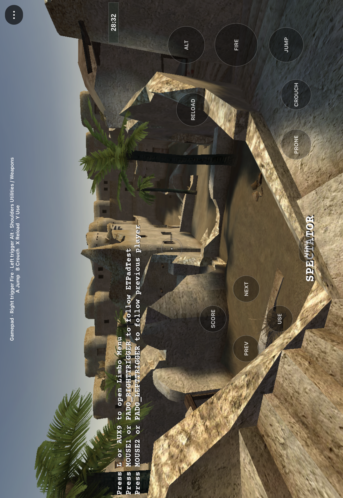
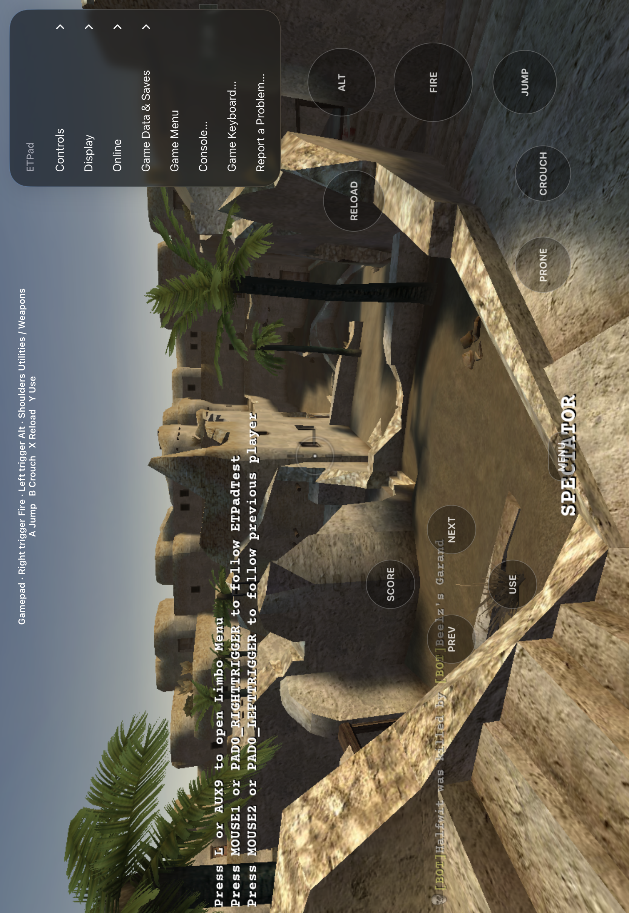
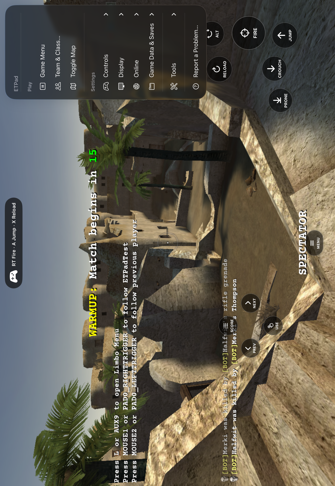
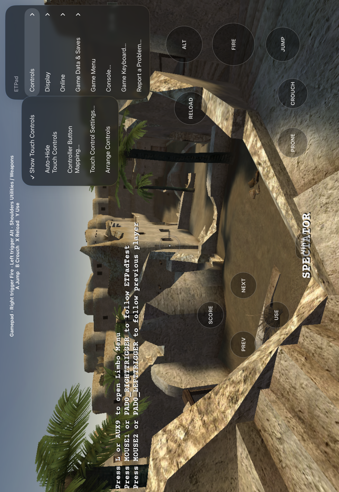
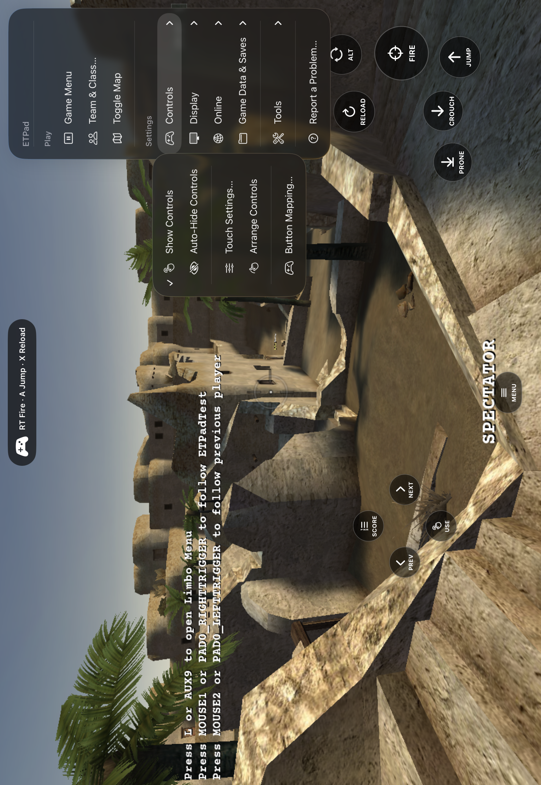

# iPad controls and native menu design pass

2026-11-16 · Scope: touch controls, the native three-dot menu and its Controls submenu. Goal: distinguish common actions, reduce obstruction and shorten the path from the menu to play. Real engine actions, native menus, persistent preferences and saved layouts were retained.

Before and after captures come from this design run through Computer Use and guarded `scripts/sim.sh`, using only reserved iPad Simulator `672DC5A6-8C79-465E-8ABC-50E57C8F7B80`. Each referenced image was opened and inspected. Raw framebuffers can contain rotated landscape content; these are simulator captures, not physical-device photographs. Source grounding: [touch overlay](../apple/ios/Host/GoldenPadTouchOverlay.swift) and [native menu](../apple/ios/Host/GameViewController.swift).

## 1. Gameplay controls — improved hierarchy; physical feel unconfirmed

| Before | After |
| --- | --- |
|  |  |

**Before finding:** Large, widely spaced circles gave combat, movement and utility actions similar visual weight despite small labels. MENU covered part of SPECTATOR. The aiming center was mostly open, and black translucent resting faces were a useful foundation.

**Change and evidence:** System icons now supplement short labels; FIRE has stronger primary emphasis, and secondary actions form a tighter thumb group. The utility diamond remains separate. MENU sits below the spectator label, while the white ellipsis capsule and compact controller prompt are visually distinct from gameplay controls. Opacity affects faces rather than fading icons/text. Final button dimensions now clamp to at least 44 UIKit points after scaling, addressing the earlier base-size/scaling risk in code.

The simulator run verified both landscapes, held FIRE reducing ammunition 30→25, stable release, RELOAD to 30/25, and the mirrored left-handed layout at Size 0.7. [Active engineer gameplay](evidence/ios-sim/design-after-gameplay.png) and [small left-handed layout](evidence/ios-sim/design-left-small.png) supplement the spectator comparison. Physical thumb reach and simultaneous multi-touch remain unconfirmed; different active HUDs and scenery still need broader checks.

## 2. Three-dot root menu — clearer tasks and a direct play shortcut

| Before | After |
| --- | --- |
|  |  |

**Before finding:** Controls, Display, Online, Data, Game Menu, Console, Keyboard and Report shared an uninterrupted list, making immediate actions and settings categories hard to distinguish. Native material, alignment and submenu chevrons already worked.

**Change and evidence:** Play actions now lead with Game Menu, Team & Class and Toggle Map. Settings categories form their own group; Console and Game Keyboard sit under Tools, with Report separately identifiable. SF Symbols reinforce complete labels. The compact connected-controller prompt opens bindings. Native **Team & Class → Allies → engineer → OK** produced a first-tap spawn in the simulator, so the new shortcut is backed by actual gameplay behavior. Physical keyboard navigation, focus return and VoiceOver order have not been accepted.

## 3. Controls submenu — shorter groups and one auto-hide preference

| Before | After |
| --- | --- |
|  |  |

**Before finding:** Auto-Hide Touch Controls and Controller Button Mapping wrapped; toggles, touch layout editing and controller mapping had equal grouping. The enabled checkmark was already useful.

**Change and evidence:** Visibility controls, touch layout actions and controller mapping are separated by native dividers and supported by icons. Labels are Show Controls, Auto-Hide Controls, Touch Settings…, Arrange Controls and Button Mapping…. Longer descriptions are retained as native discoverability titles; their VoiceOver presentation still needs testing. The auto-hide menu item and settings switch now edit one canonical preference; their consistency was exercised in the simulator. The final rebuilt Controls capture confirms all five labels fit on single lines, including Button Mapping…. The mapping action opens its native sheet, and Done returns to the game.

## Remaining verification

The accepted run establishes simulator visuals, menu actions, first-tap team/class selection, basic action hold/release, mirrored Size 0.7 and synchronized auto-hide state. It does not certify physical controller play, physical multi-touch comfort, arrange-drag feel, or accessibility compliance. Still check a real iPad, simultaneous move/look/fire, varied HUD/background contrast, larger text/localization, VoiceOver labels/focus and hardware keyboard/trackpad behavior. The final rebuilt after captures were inspected, including the refreshed Controls submenu. Native sheet open/Done return passes; the simulator was shut down after validation.
