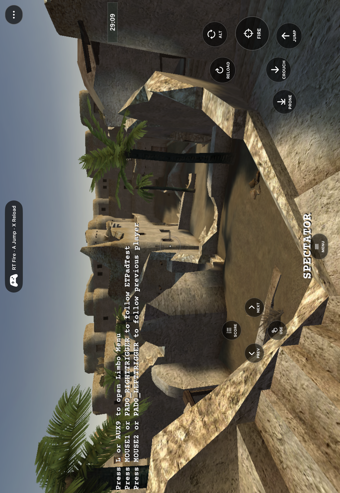
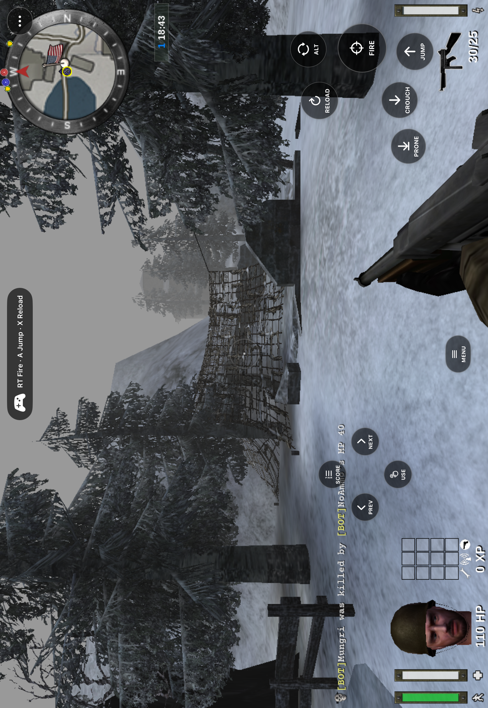
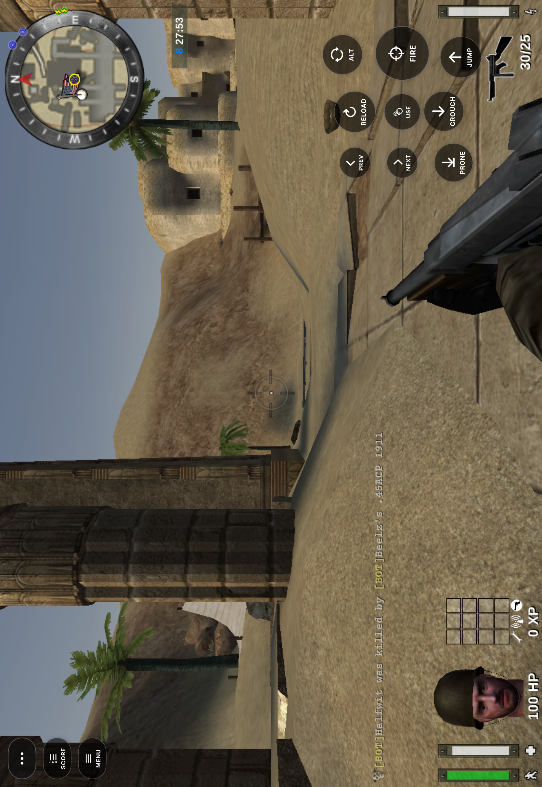
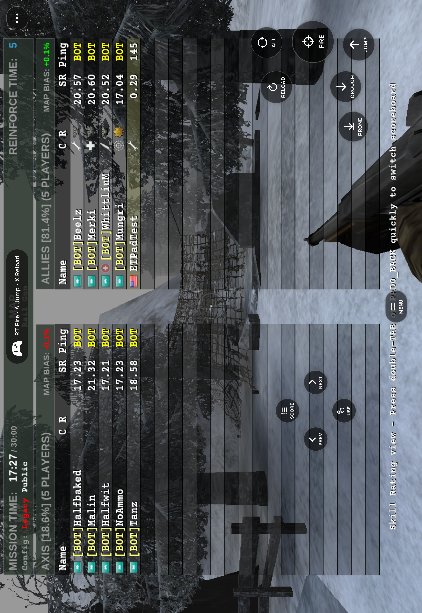
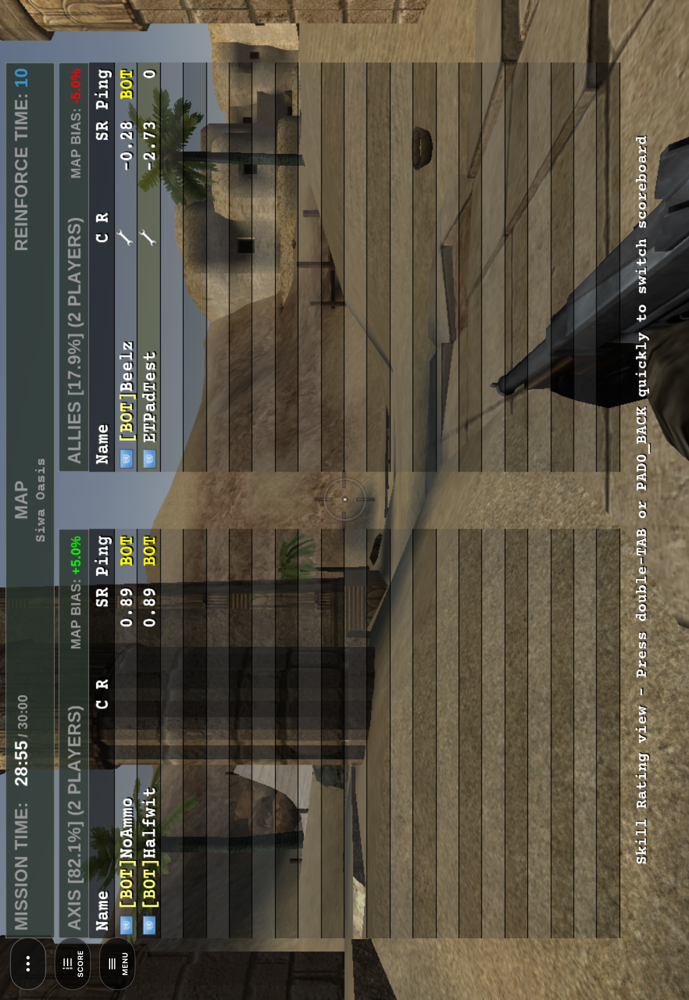
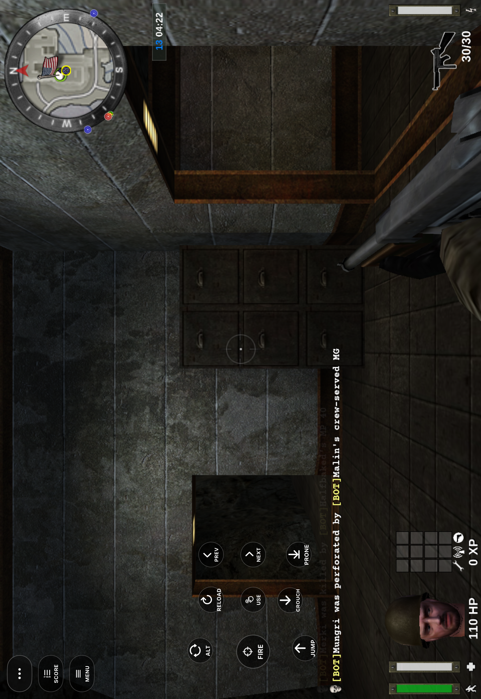

# iPad controls and native menu design pass

2026-11-16 · Scope: touch controls, the native three-dot menu and its Controls submenu. Goal: distinguish common actions, reduce obstruction and shorten the path from the menu to play. Real engine actions, native menus, persistent preferences and saved layouts were retained.

Historical first-pass before and after captures come from this design run through Computer Use and guarded `scripts/sim.sh`, using only reserved iPad Simulator `672DC5A6-8C79-465E-8ABC-50E57C8F7B80`. Each referenced image was opened and inspected. Raw framebuffers can contain rotated landscape content; these are simulator captures, not physical-device photographs. Source grounding: [touch overlay](../apple/ios/Host/GoldenPadTouchOverlay.swift) and [native menu](../apple/ios/Host/GameViewController.swift).

## Historical first pass — accepted visual hierarchy

These captures document the earlier icon/menu pass. Its utility diamond and corner anchors have since been superseded in source by the HUD-aware placement described below.

### 1. Gameplay controls — improved hierarchy; physical feel unconfirmed

| Before | After |
| --- | --- |
|  |  |

**Before finding:** Large, widely spaced circles gave combat, movement and utility actions similar visual weight despite small labels. MENU covered part of SPECTATOR. The aiming center was mostly open, and black translucent resting faces were a useful foundation.

**Change and evidence:** System icons now supplement short labels; FIRE has stronger primary emphasis, and secondary actions form a tighter thumb group. The utility diamond remains separate. MENU sits below the spectator label, while the white ellipsis capsule and compact controller prompt are visually distinct from gameplay controls. Opacity affects faces rather than fading icons/text. Final button dimensions now clamp to at least 44 UIKit points after scaling, addressing the earlier base-size/scaling risk in code.

The simulator run verified both landscapes, held FIRE reducing ammunition 30→25, stable release, RELOAD to 30/25, and the mirrored left-handed layout at Size 0.7. [Active engineer gameplay](evidence/ios-sim/design-after-gameplay.png) and [small left-handed layout](evidence/ios-sim/design-left-small.png) supplement the spectator comparison. Physical thumb reach and simultaneous multi-touch remain unconfirmed; different active HUDs and scenery still need broader checks.

### 2. Three-dot root menu — clearer tasks and a direct play shortcut

| Before | After |
| --- | --- |
|  |  |

**Before finding:** Controls, Display, Online, Data, Game Menu, Console, Keyboard and Report shared an uninterrupted list, making immediate actions and settings categories hard to distinguish. Native material, alignment and submenu chevrons already worked.

**Change and evidence:** Play actions now lead with Game Menu, Team & Class and Toggle Map. Settings categories form their own group; Console and Game Keyboard sit under Tools, with Report separately identifiable. SF Symbols reinforce complete labels. The compact connected-controller prompt opens bindings. Native **Team & Class → Allies → engineer → OK** produced a first-tap spawn in the simulator, so the new shortcut is backed by actual gameplay behavior. Physical keyboard navigation, focus return and VoiceOver order have not been accepted.

### 3. Controls submenu — shorter groups and one auto-hide preference

| Before | After |
| --- | --- |
|  |  |

**Before finding:** Auto-Hide Touch Controls and Controller Button Mapping wrapped; toggles, touch layout editing and controller mapping had equal grouping. The enabled checkmark was already useful.

**Change and evidence:** Visibility controls, touch layout actions and controller mapping are separated by native dividers and supported by icons. Labels are Show Controls, Auto-Hide Controls, Touch Settings…, Arrange Controls and Button Mapping…. Longer descriptions are retained as native discoverability titles; their VoiceOver presentation still needs testing. The auto-hide menu item and settings switch now edit one canonical preference; their consistency was exercised in the simulator. The final rebuilt Controls capture confirms all five labels fit on single lines, including Button Mapping…. The mapping action opens its native sheet, and Done returns to the game.

### First-pass verification limits

The accepted run establishes simulator visuals, menu actions, first-tap team/class selection, basic action hold/release, mirrored Size 0.7 and synchronized auto-hide state. It does not certify physical controller play, physical multi-touch comfort, arrange-drag feel, or accessibility compliance. Still check a real iPad, simultaneous move/look/fire, varied HUD/background contrast, larger text/localization, VoiceOver labels/focus and hardware keyboard/trackpad behavior. The final rebuilt after captures were inspected, including the refreshed Controls submenu. Native sheet open/Done return passes; the simulator was shut down after validation.

## HUD-aware placement pass — verified simulator states

The subsequent live Railgun screenshots revealed functional placement problems that the spectator-first comparison did not expose. The latest user request prioritizes logical HUD-aware placement over retaining the historical utility diamond. Both Railgun before captures and all three final after captures were opened and inspected. The after views cover Oasis normal gameplay/scoreboard and Fuel Dump small left-handed gameplay; they are checks of actual HUD states, not identical-map image comparisons.

### 1. Live gameplay — protect movement, killfeed and compass

**Observed:** SCORE intersects the killfeed; the diamond places USE and weapon cycling away from the right-hand combat group and inside the left movement side. The native upper-right ellipsis also occupies compass space. These are active-HUD problems, not just visual styling.

**Implemented:** Remove the utility diamond. Move USE beside FIRE (right inset 172, bottom inset 190; 56 points); place PREV/NEXT next to weapon actions (right inset 250, bottom insets 263/190; 48 points). Leave the left movement region free of these buttons. Put occasional SCORE/MENU actions in the left HUD gutter: centers (44,88)/(44,142), fixed 64×44 points; native ellipsis rectangle x=12–76/y=12–56 during gameplay. Coordinates are relative to the safe area. Rendered ET main/Limbo menus keep their native upper-right ellipsis anchor. The connection hint becomes temporary during play rather than occupying the HUD continuously.

**Verified:** The active Oasis engineer capture shows 100 HP and 30/25 ammunition, right-hand USE/weapon controls, no utility diamond in the movement region, clear killfeed and compass, and the three occasional controls inside the left gutter. The persistent controller hint is absent. This establishes visible clearance in this state; physical thumb travel and the full range of dynamic HUD messages remain untested.

### 2. Scoreboard — remove competing controls and preserve hold/release

**Observed:** Opening SCORE leaves combat buttons and the controller chip over the two player tables, obscuring information the user deliberately opened.

**Implemented:** Query actual engine scoreboard/intermission flags through VM_Call, including activation outside touch input. Hide combat controls and the controller hint, release combat actions and zero movement/look axes. Keep SCORE/MENU in the gutter. State changes never synthesize `-scores`; the held SCORE button must remain available for normal touch-up/cancel release. The gameplay connection hint lasts eight seconds, while host-only setup retains access; native menu button mapping remains available.

**Verified:** Actual engine `+scores` state hides combat controls and the hint. The inspected capture leaves player columns and headings unobstructed, with SCORE/MENU outside them in the left gutter. A 1.5-second native SCORE hold followed by release closes the board and restores combat controls without stranding the score state. Physical controller activation and a broad set of intermission/HUD configurations are not inferred from this test.

### 3. Left-handed and small layouts — mirror actions, keep HUD anchors stable

**Correction:** A naive mirror put combat buttons over the left health/class HUD. Default left-handed combat centers are now lifted **180 UIKit points** above their mirrored starting positions to clear that fixed HUD and the two-line killfeed. The default SCORE/MENU gutter does not mirror or change from 64×44 as Size changes. The lift applies only where no custom center is saved; explicit custom coordinates and their prior mirroring semantics remain intact.

**Verified:** The corrected Fuel Dump capture shows Size 0.7 left-handed controls, 110 HP and 30/30 ammunition. The combat cluster sits above the health/class block and two-line killfeed; SCORE/MENU stay in the fixed left gutter. The initial overlapping mirror was corrected before this accepted capture. Custom-layout preservation is an implementation property, not a claim that every saved layout was exercised.

Normal gameplay placement, scoreboard hold/release and corrected small left-handed placement now have simulator evidence. Physical simultaneous move/look/fire, thumb reach, comfort, wider HUD/background coverage and assistive technology still need testing. These observed layouts do not establish all-HUD clearance, physical ergonomics or accessibility compliance.
